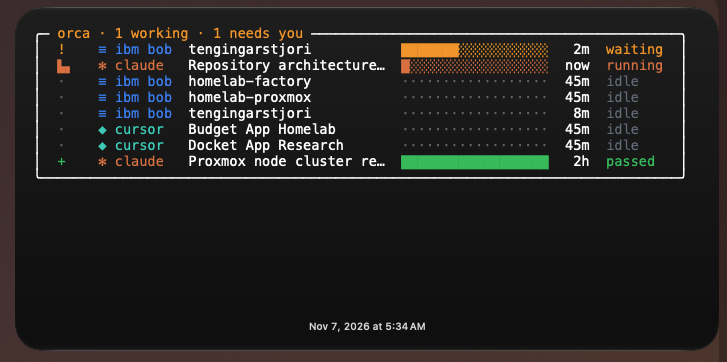

# tw-orca-tracking

A live desktop widget that shows which AI agents are running in [Orca](https://www.onorca.dev) and what each is doing: Claude, Cursor, IBM Bob, Ollama and more, on a [TerminalWidget](https://terminalwidget.app) widget.



*The `pipeline` style. The default `ascii` style looks like this:*

```
agent      workspace     task                 state             since
◈ cursor   web           #87 Fix navbar       ! needs you       1m
≡ ibm bob  billing       PR 12                / [===>      ]    2m
✻ claude   api/feat-x    ENG-142 Add auth     - [=>        ]    now
♞ ollama   sandbox                            · idle            3m
orca · 2 working · 1 needs you                                  04:23
```

Each agent has its own mark and color. You can see at a glance who's working, who's waiting on you, and who's done. You also get a macOS notification when an agent needs input. The look is inspired by [ascii.rest](https://ascii.rest).

## Install

You need macOS with [Orca](https://www.onorca.dev) and [TerminalWidget](https://terminalwidget.app) installed.

1. **Link the widget's command:**
   ```bash
   ln -s /Applications/TerminalWidget.app/Contents/MacOS/TerminalWidget ~/bin/terminal-widget
   ```
2. **Add the widget.** Place an **extra-large** TerminalWidget widget on your desktop. Open *Edit Widget* and set **Target name** to `orca-agents`.
3. **Clone and install:**
   ```bash
   git clone git@github.com:greyhoundforty/tw-orca-tracking.git && cd tw-orca-tracking
   ./install.sh
   ```
   This starts a background job that checks Orca every 5 seconds and updates the widget when something changes.
4. **Turn on Orca's status hooks:** run `orca agent hooks status` and check that `claude` and `cursor` show `installed`. If they don't, run `orca agent hooks on`.

## Use

Just run your agents in Orca as usual. There's nothing to start or stop.

| You see | It means |
|---|---|
| `/ [===>      ]` | Working. The spinner turns and the bar fills over time |
| `! needs you` | Waiting for your approval or input, with a notification |
| `· idle` / `+ done` | Idle, or finished its turn |

Tap the widget to open Orca.

**Changing the look:** set an option when you install. For example, this switches to the pipeline layout with the loop spinner:

```bash
ORCA_TW_STYLE=pipeline ORCA_TW_SPINNER=loop ./install.sh
```

There are four styles: `ascii` (default), `pipeline`, `flap` (a departures board) and `table`.

**Useful commands:**

```bash
orca-widget-sync --watch   # see state changes live in your terminal
./install.sh status        # check the background job
./install.sh uninstall     # remove it
```

## More

Everything else is in [CONFIGURE.md](CONFIGURE.md): every style and state, agent marks and colors, how Bob and Ollama are detected without hooks, all settings, and troubleshooting. Design notes are in [RESEARCH.md](RESEARCH.md).
