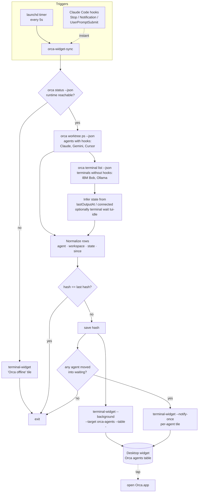

# Orca → TerminalWidget agent monitor: research notes

_Checked against Orca CLI 1.4.251 and the TerminalWidget build in /Applications, 2026-11-07._

## TL;DR

- **Use the CLI, not AppleScript.** `terminal-widget` and AppleScript feed the same update pipeline, so neither can do more than the other. The CLI takes stdin (`--table -`, `--text -`) and has a quiet `--background` mode. It also needs no Apple Events/TCC permission and fits in a shell loop next to `orca … --json | jq`.
- **Data source: `orca worktree ps --json`.** It returns each workspace with an `agents[]` array (`agentType`, `state`, `conversationName`, `stateStartedAt`, `programStatus`). Orca fills this array from **agent status hooks**.
- **Gap:** status hooks are installed for `claude`, `gemini`, `cursor` and `hermes`. **IBM Bob and Ollama aren't in Orca's hook list**, so they never show up in `agents[]`. Instead, track them as terminals: `orca terminal list --json` gives `title`, `agentIdentity` and `lastOutputAt`, and you can work out busy/idle from output activity.
- **Orca has no push/stream API.** There's no `watch`, `events` or `stream` command; the only blocking primitive is `orca terminal wait --for tui-idle`. Updates therefore come from **polling on the host** (launchd, every 5–10 s). You can optionally add **Claude Code hooks** that start a refresh right away.
- TerminalWidget's own `--auto-update` can't do this: its minimum interval is 60 s and it only supports `shortcut` or `image-url` sources. Run the poller on the host and push with the CLI.

## Orca: what the data looks like

### `orca worktree ps --json` (main source)

```jsonc
{ "result": { "worktrees": [ {
    "repo": "homelab-proxmox", "displayName": "main",
    "status": "active",            // active | inactive
    "liveTerminalCount": 1, "lastOutputAt": 1794042565895,
    "agents": [ {
      "agentType": "claude",       // claude | cursor | gemini | …
      "state": "done",             // see state table below
      "conversationName": "Proxmox node cluster reset",
      "stateStartedAt": 1794038956262,
      "hasLivePty": true,
      "programStatus": { "state": "idle" },
      "toolName": null, "lastAssistantMessage": null
    } ]
} ] } }
```

Note: `agents[]` keeps entries for workspaces that have no live terminals. Filter on `hasLivePty == true` (or `liveTerminalCount > 0`) unless you want history too.

### `orca terminal list --json` (fallback for agents without hooks)

```jsonc
{ "handle": "term_…", "worktreePath": "…", "title": "Proxmox node cluster reset",
  "connected": true, "lastOutputAt": 1794042565895, "agentIdentity": "claude" }
```

For Bob and Ollama, identify the terminal by `title` or by the command you launched it with (`orca terminal create --title "bob: …" --command bob`). Then infer state from output:

| Signal | Inferred state |
|---|---|
| `now - lastOutputAt < ~5s` | `working` |
| quiet, last screen line looks like a prompt (`orca terminal read --screen`) | `waiting` / `idle` |
| `connected == false`, or the terminal is gone | `exited` |

`orca terminal wait --terminal <h> --for tui-idle --timeout-ms N` can confirm idle without guessing from timestamps.

### State values

**Confirmed** from the Orca app bundle (`new Set(["working","blocked","waiting","done","idle"])`). Orca's own notifications treat `blocked` and `waiting` as "needs input". The implemented mapping is in [README.md](README.md). Original suggestion:

| Orca state | Widget icon (SF Symbol) | Color |
|---|---|---|
| `working` / `running` | `bolt.circle.fill` | `#3b82f6` |
| `waiting` / `needs-input` | `hand.raised.circle.fill` | `#f59e0b` (+ notify) |
| `done` / `idle` | `checkmark.circle.fill` | `#22c55e` |
| error / exited | `xmark.octagon.fill` | `#ef4444` |

## TerminalWidget: relevant capabilities

- Install: `ln -s /Applications/TerminalWidget.app/Contents/MacOS/TerminalWidget ~/bin/terminal-widget`
- Target a widget you placed and named in *Edit Widget → Target name*: `--target orca-agents`
- **Table:** `--table -` reads CSV/TSV/JSON from stdin, e.g. `--grid zebra --table-layout auto --fit-text`. This is the best fit for "all agents at a glance".
- **Per-agent tile:** `--text`, `--icon`, `--fg`, `--title`, `--caption-text`, `--timestamp`
- **Quiet push:** `--background` doesn't bring the app forward.
- **Alerts:** `--notify-once` when an agent moves to `waiting` (it needs you).
- **Tap action:** `--action-kind open-app --action-value Orca` makes a tap jump into Orca.
- **Debugging:** `terminal-widget log --follow --target orca-agents`

## Recommended design

1. **`orca-widget-sync`** (shell + jq, or a small Python script), run by a launchd agent every **5 s**:
   1. `orca status --json`. If the runtime is unreachable, push an "Orca offline" tile and stop.
   2. `orca worktree ps --json`: build rows for agents that have hooks.
   3. `orca terminal list --json`: add rows for Bob and Ollama terminals that `agents[]` doesn't cover, using the activity heuristic.
   4. Normalize each row to `agent | workspace | state | since`.
   5. Hash the rows and compare with the previous hash in `~/.cache/orca-widget/last`. **If nothing changed, exit without pushing**, so the widget isn't redrawn every 5 s.
   6. If something changed, push the table (`--target orca-agents`). For each agent that moved into `waiting`, also send `--notify-once` to its own tile.
2. **Optional instant path:** add Claude Code hooks (`Stop`, `Notification`, `UserPromptSubmit`) that run `orca-widget-sync`, so Claude changes show up in under 1 s instead of after the next poll.
3. Use `orca terminal create --title "bob …"` / `"ollama …"` when you launch those agents, so the fallback matcher can find them reliably.

### Sketch

```bash
#!/usr/bin/env bash
set -euo pipefail
TW=~/bin/terminal-widget; CACHE=~/.cache/orca-widget; mkdir -p "$CACHE"

if ! orca status --json | jq -e '.result.runtime.reachable' >/dev/null; then
  $TW --background --target orca-agents --icon wifi.slash --text "Orca offline" --fg ef4444; exit
fi

hooked=$(orca worktree ps --json | jq -r '
  .result.worktrees[] as $w | $w.agents[] | select(.hasLivePty) |
  [.agentType, ($w.repo+"/"+$w.displayName), .state, (.stateStartedAt/1000|floor)] | @csv')

now=$(date +%s)
unhooked=$(orca terminal list --json | jq -r --argjson now "$now" '
  .result.terminals[] | select(.title|test("^(bob|ollama)";"i")) |
  [(.title|split(" ")[0]), (.worktreePath|split("/")[-1]),
   (if (.connected|not) then "exited"
    elif ($now - (.lastOutputAt/1000)) < 5 then "working" else "idle" end),
   (.lastOutputAt/1000|floor)] | @csv')

table=$(printf 'Agent,Workspace,State,Since\n%s\n%s\n' "$hooked" "$unhooked" | sed '/^$/d')
hash=$(printf %s "$table" | shasum | cut -d' ' -f1)
[[ "$hash" == "$(cat "$CACHE/last" 2>/dev/null)" ]] && exit 0
echo "$hash" > "$CACHE/last"

printf %s "$table" | $TW --background --target orca-agents --table - \
  --grid zebra --table-layout auto --fit-text --title "Orca agents" --timestamp \
  --action-kind open-app --action-value Orca
```

(Sketch only. "Since" is an epoch timestamp; format it as "3m ago" in jq or Python. Waiting-state notifications aren't wired up yet.)

## Flow diagram


